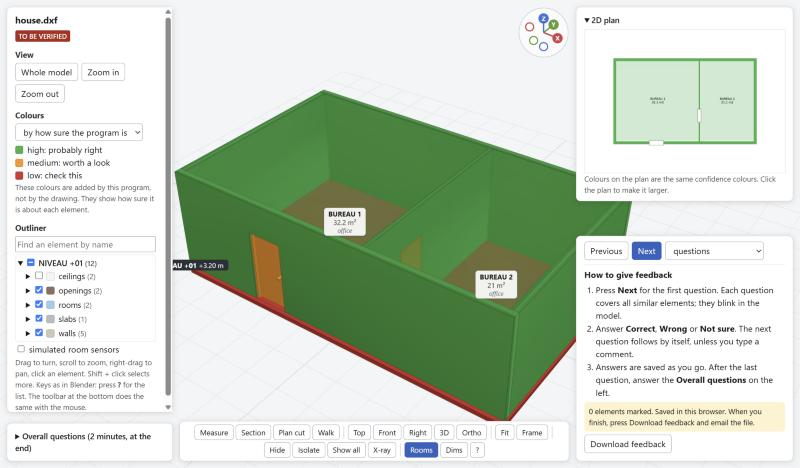
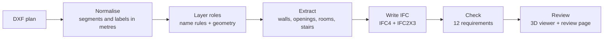

<div align="center">

# dxf2ifc

**From a 2D floor plan to a BIM model an engineer can check, in seconds.**

dxf2ifc reads a DXF floor plan and writes a valid IFC model: walls, openings, slabs, rooms, stairs, columns and the structural grid.
Every element records where it came from in the drawing and how sure the converter is, so the review starts where it matters.




<sub>A converted test plan in the built-in 3D viewer: confidence colours, outliner, room labels with area and use, the source plan and the review questions.</sub>

</div>

---

## Contents

- [Why](#why)
- [What it does](#what-it-does)
- [Quick start](#quick-start)
- [How it works](#how-it-works)
- [What the IFC contains](#what-the-ifc-contains)
- [Quality checks](#quality-checks)
- [Results on a real dataset](#results-on-a-real-dataset)
- [The 3D viewer](#the-3d-viewer)
- [Commands](#commands)
- [Optional: a language model for unknown layers](#optional-a-language-model-for-unknown-layers)
- [Project layout](#project-layout)
- [Team and licence](#team-and-licence)

## Why

Engineering offices receive their clients' floor plans as 2D DXF drawings, and every client draws differently: layer names in French, German or English, walls as pairs of lines or as hatches, rooms as loose text.
To check a building in a BIM tool, someone first redraws it by hand. That takes days.

dxf2ifc does the redrawing in seconds and is honest about it. It never guesses silently: anything uncertain is marked, explained and placed on a short review list.

## What it does

|  |  |
|---|---|
| **Reads any DXF floor plan** | Text and binary DXF, metres to inches, nested blocks and xrefs flattened, labels in French, German and English. |
| **Finds the building elements with rules, not a black box** | Layer names and geometry decide what is a wall, door, window, stair, column or room. No machine learning is needed; a language model is optional and only sees layer names. |
| **Writes clean IFC4 and IFC2X3** | Storeys, walls with material layers, openings filled with doors and windows, slabs, rooms as `IfcSpace`, stairs, railings, columns, beams and an `IfcGrid`. No two elements share space. |
| **Enriches every element** | Standard property sets (`Pset_*Common`), base quantities (`Qto_*BaseQuantities`), materials, and rooms with name, area and use. |
| **Shows its confidence** | Every element carries a confidence level, the rule that made it and its source handles in the drawing. |
| **Checks itself** | 12 requirement checks run on every model, from schema validity to room areas against the areas printed on the plan. |
| **Makes review fast** | A review page lists only what needs a human, each item with a crop of the plan and a link to the element in 3D. |
| **Runs anywhere, for free** | Plain Python on a laptop CPU. About 2 seconds per plan, no GPU, no paid service, nothing leaves the computer. |

## Quick start

**Requirements:** Python 3.10 or newer. Built and tested on Windows with Python 3.13 and 3.14.

```bash
python -m venv .venv
.venv\Scripts\python -m pip install -r requirements.txt
```

### In the browser

```bash
.venv\Scripts\python -m dxf2ifc serve
```

Open http://127.0.0.1:8000 and drop one or more DXF files on the page. Each plan is converted on your computer and appears as a card with its 3D view, review page, side-by-side view and both IFC files.

### From the command line

```bash
.venv\Scripts\python -m dxf2ifc run plan.dxf --out out\plan
```

| Output | What it is |
|---|---|
| `model.ifc` | The IFC4 model, coloured by confidence in any IFC viewer |
| `model_ifc2x3.ifc` | The same model in IFC2X3, for tools and workflows that still use it |
| `viewer.html` | The 3D viewer, one self-contained file that works offline |
| `review.html` | The review page: assumed values, the checks, and the items to verify |
| `compare.html` | The 2D plan and the 3D model side by side |
| `plan.json` | Everything that was extracted, as plain data |
| `roles.json` | What each drawing layer was taken to mean |

Useful options: `--elevation 7.48` and `--height 3.13` set the storey level and height in metres, `--project NAME` keeps element IDs stable across revisions of a drawing, and `--bbox xmin,ymin,xmax,ymax` converts one part of a sheet.

### Several storeys

```bash
.venv\Scripts\python -m dxf2ifc merge out\level1\plan.json out\level2\plan.json --out out\building.ifc
```

Storeys are stacked into one building, with a flat roof over the top storey marked as an assumption.

## How it works



1. **Normalise** (`normalize.py`). Any DXF becomes line segments and joined text labels in metres. Blocks and xrefs are flattened.
2. **Layer roles** (`roles.py`). Each layer is sorted into walls, doors, windows, stairs, columns, furniture, text and so on, by keyword rules in three languages and AIA layer names. If no layer is named for walls, walls are found by line weight. A confirmed mapping can be saved and reused for the next drawing with the same layers.
3. **Extract** (`extract.py`). Pairs of parallel lines become walls; gaps and door swings become openings; closed spaces become rooms, named by the labels inside them; runs of treads become stairs. Overlaps are resolved here: doors and windows are trimmed where they cross another wall, and furniture is kept clear of doors.
4. **Write** (`to_ifc.py`). The IFC model, with property sets, quantities, materials and a trust record on every element. Element IDs are derived from the drawing, so a second run gives the same IDs.
5. **Check and review** (`qa.py`, `review.py`, `viewer.py`). The requirement checks, the review page and the 3D viewer.

Every threshold lives in [`dxf2ifc/config.py`](dxf2ifc/config.py), each with the reason for its value.

## What the IFC contains

| Element | IFC entity | Data attached |
|---|---|---|
| Project, site, building, storeys | `IfcProject`, `IfcSite`, `IfcBuilding`, `IfcBuildingStorey` | names, elevations, drawing georeference |
| Walls | `IfcWall` | `Pset_WallCommon`, `Qto_WallBaseQuantities`, `IfcMaterialLayerSet` |
| Doors and windows | `IfcDoor`, `IfcWindow` in an `IfcOpeningElement` | width, height, sill, host wall |
| Floor slabs | `IfcSlab` | `Pset_SlabCommon`, `Qto_SlabBaseQuantities`, material |
| Rooms | `IfcSpace` | name, floor area, use, `Pset_SpaceCommon`, `Pset_SpaceOccupancyRequirements`, `Qto_SpaceBaseQuantities` |
| Stairs and railings | `IfcStair`, `IfcRailing` | `Pset_StairCommon`, `Pset_RailingCommon` |
| Columns and beams | `IfcColumn`, `IfcBeam` | `Qto_ColumnBaseQuantities`, `Qto_BeamBaseQuantities` |
| Ceilings | `IfcCovering` | `Qto_CoveringBaseQuantities` |
| Furniture and fixtures | `IfcFurnishingElement`, `IfcFlowTerminal` | type as drawn |
| Structural grid | `IfcGrid` | axis tags as drawn |
| Fire-safety symbols | typed `IfcBuildingElementProxy` | extinguishers, detectors, exit signs |

Every element also carries a trust property set: **confidence** (high, medium or low), the **rule** that produced it, its **source handles and layer** in the DXF, and a **to-be-verified** flag. Viewers that colour by property show the confidence at a glance.

## Quality checks

Each model is checked against requirements we defined from what an engineer needs before trusting a model. The results are written to `checks.json` and shown on the review page.

| | Requirement | Pass when |
|---|---|---|
| R1 | The IFC file is valid | 0 schema errors |
| R2 | Project, site, building and storeys with name and elevation | all present |
| R3 | Walls have a body, a thickness and `Pset_WallCommon` | every wall |
| R4 | Doors have a width and a height and sit in an opening in a wall | every door |
| R5 | One floor slab per storey | at least one per storey |
| R6 | Rooms have a name and a floor area | every room |
| R7 | Elements carry a confidence and their source | every element |
| R8 | A second run gives the same element IDs | identical |
| R9 | Room areas match the areas printed on the plan | within 5 % |
| R10 | Wall lines in the drawing become walls | at least 85 % of their length |
| R12 | Fast and free to run | under 60 s, at most 1 language-model call |
| R13 | No two elements share space | 0 overlapping pairs (1 mm tolerance) |

R11, accuracy on synthetic plans with a known answer, runs separately with `python -m dxf2ifc bench`.

## Results on a real dataset

The full pipeline was run on every plan-like drawing of a real dataset of engineering drawings:

| | |
|---|---|
| DXF files scanned | **15,971** |
| Floor plans converted end to end | **2,599** |
| Finished without error | **2,591** (99.7 %) |
| Median time per plan | **2.0 s** on a laptop CPU |
| Median share of wall lines turned into walls | **84 %** |
| Rooms checked against a printed area | **5,808** |
| Rooms within 5 % of the printed area | **50 %** |
| Stairs found | **7,033** in 1,607 plans |
| Fire-safety symbols found | **1,744** in 168 plans |

On the five showcase plans, every model is valid with **zero overlapping elements**. One plan passes all 12 checks; the other four pass 11 of 12, with room areas (R9) or wall-line coverage (R10) as the open point. These are reported, not hidden: the review page names every room whose area does not match.

## The 3D viewer

`viewer.html` is a single file with three.js inside. It opens offline in any modern browser, and its controls follow Blender, so they feel familiar to anyone who models.

- **Navigate:** orbit, pan, zoom; front, right and top views on 1, 3 and 7; orthographic on 5; an axis gizmo; frame the selection with F.
- **Inspect:** hover for a tag, click for the IFC ID, property sets, quantities, rule and source. Shift-click several elements to get their total length, area and volume.
- **Cut:** a section box with draggable handles (Shift+B), or a horizontal cut at 1.2 m like a printed plan (Alt+B). Cut faces are filled.
- **Organise:** an outliner tree with search and show/hide per element or type; hide, isolate and X-ray.
- **Measure and read:** point-to-point measure, wall dimensions, the structural grid with its axis labels, storey levels, room labels with area and use.
- **Walk:** first-person walk with W A S D.
- **Review:** step through the elements the converter is unsure about, mark each Correct, Wrong or Not sure, and download the answers.

Press **?** in the viewer for the full key list. The toolbar does the same with the mouse.

## Commands

| Command | What it does |
|---|---|
| `run <plan.dxf>` | Convert one plan |
| `serve` | Local home page: drop DXF files, browse conversions |
| `merge <plan.json>...` | Stack storeys into one building |
| `bench` | Accuracy on synthetic plans with a known answer |
| `triage <folder-or-zip>` | Fast scan of many DXF files to find the floor plans |
| `shortlist <index.csv>` | Rank scanned files and draw thumbnails |
| `batch <index.csv>` | Run the pipeline on every plan-like file and record the results |
| `profile-ifc <model.ifc>` | List what an IFC file contains |
| `save-mapping <roles.json>` | Keep a confirmed layer mapping for drawings with the same layers |
| `share-pack <plans>... --offline` | Package converted plans and the converter as one folder to send |
| `feedback <files>` | Sum up the review answers |

All commands run as `python -m dxf2ifc <command>`; add `--help` to any of them for its options.

## Optional: a language model for unknown layers

The rules recognise most layer names. For the few they cannot place, one question can go to a language model. It receives only layer names, entity counts and a few text samples with every digit masked, never the geometry. Answers are cached, so a second run on the same drawing makes no call.

To turn it on, create a `.env` file in the project folder:

```ini
LLM_PROVIDER=groq            # groq, openrouter, ollama (fully local) or none
LLM_MODEL=qwen/qwen3.8-27b
GROQ_API_KEY=<your key>      # or OPENROUTER_API_KEY / LLM_API_KEY
```

On a test plan whose five layers had names no rule knows, rules alone placed 1 of 5; with the model, all 5 were right in 0.3 s. With `ollama`, everything stays on the computer.

## Project layout

```text
dxf2ifc/
├── dxf2ifc/
│   ├── normalize.py      DXF to segments and labels in metres
│   ├── roles.py          layer roles from name rules and geometry
│   ├── llm.py            optional language-model step for unknown layers
│   ├── extract.py        walls, openings, rooms, stairs, columns, grid
│   ├── schema.py         the plan.json contract
│   ├── to_ifc.py         IFC4 and IFC2X3 writer
│   ├── qa.py             requirement checks and overlap test
│   ├── review.py         review page
│   ├── viewer.py         3D viewer and side-by-side page
│   ├── triage.py         dataset scan and shortlist
│   ├── batch.py          dataset runs
│   ├── share.py          packaging for sharing
│   ├── cli.py            command line and local web server
│   └── config.py         every threshold, with its reason
├── tests/                171 tests on synthetic drawings
└── docs/
    └── BACKEND.md        storage options for an office-wide deployment
```

Run the tests with:

```bash
.venv\Scripts\python -m pytest -q
```

The tests generate their own drawings (`tests/fixtures.py`), so no real plan is needed.

**Going further.** [`docs/BACKEND.md`](docs/BACKEND.md) compares storage options for running dxf2ifc across a whole office: object storage for DXF and IFC files, PostgreSQL with PostGIS for elements and review results, keyed by stable IFC IDs.

## Team and licence

Built by **team MADS** at the University of Luxembourg Student AI Lab hackathon, 2026.

Released under the [MIT licence](LICENSE).
